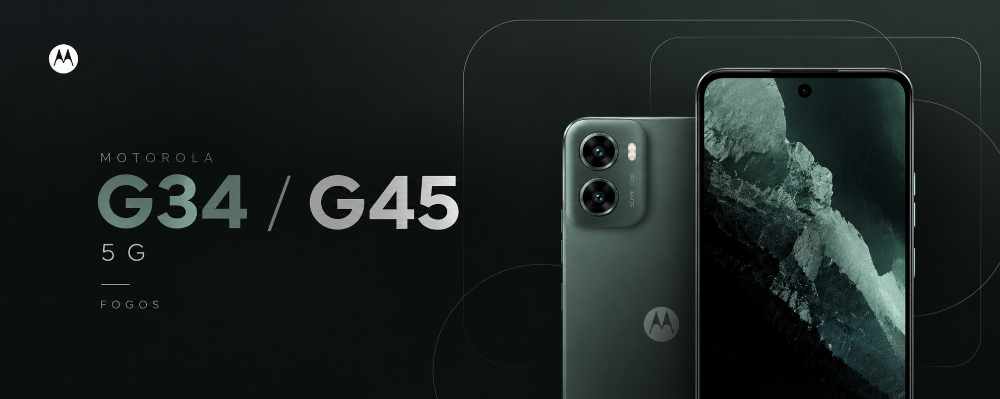

# Device tree — Motorola moto g34 5G / moto g45 5G (`fogos`)

A unified LineageOS-based device tree for the Motorola **moto g34 5G** and
**moto g45 5G**, both of which share the codename **`fogos`** and the Qualcomm
**SM6375 (`holi`)** platform.


---

## Specifications

| Component | Specification |
| --- | --- |
| Platform | Qualcomm SM6375 `holi`, 6 nm |
| SoC | Snapdragon 695 5G (moto g34 5G) / Snapdragon 6s Gen 3, SM6375-AC (moto g45 5G) |
| CPU | Octa-core Kryo 660 — 2 × performance + 6 × efficiency cores |
| GPU | Qualcomm Adreno 619 |
| Architecture | `arm64` (arm64-v8a + armeabi-v7a), `armv8-2a-dotprod` |
| RAM | 4 / 8 GB LPDDR4X |
| Storage | UFS 2.2 · 64 / 128 / 256 GB (region and model dependent) |
| SD card | microSDXC, up to 1 TB (shared SIM slot) |
| Display | 6.5" IPS LCD, 720 × 1600 (20:9), 120 Hz, 280 dpi, Gorilla Glass 3 |
| Rear camera | 50 MP f/1.8 (main, PDAF) + 2 MP f/2.4 (macro), LED flash |
| Front camera | 16 MP, 1080p30 |
| Battery | 5000 mAh Li-Po, non-removable, TurboPower wired charging |
| Audio | Stereo speakers, Dolby Atmos, 3.5 mm jack, Hi-Res audio |
| Connectivity | 5G NR / LTE / UMTS / GSM, Wi-Fi 802.11 a/b/g/n/ac dual-band, Bluetooth 5.x, NFC, FM radio, USB-C 2.0 with OTG |
| Positioning | GPS, A-GPS, GLONASS, Galileo, BeiDou, QZSS |
| Sensors | Side-mounted fingerprint, accelerometer, gyroscope, proximity, ambient light, e-compass, SAR sensor |
| Dimensions | 162.7 × 74.6 × 8.0 mm |
| Build | Glass front, plastic frame, water-repellent (IP52) |
| Shipped Android | 17  |


---

## A note on commit authorship

This tree consolidates work from across the custom ROM community, and
**authorship of every commit has been preserved as it was in the original
history** — original authors, emails, dates and commit messages are intact.
Nothing has been re-attributed, and no commits were squashed in a way that
strips their original credit.


## Credits

- **Motorola, LineageOS** — for the base device support, extract
  utilities and HAL implementations.
- The `sm6375` / `holi` platform maintainers and every contributor whose
  commits live in this history .

## Disclaimer

```
/*
 * Your warranty is now void.
 *
 * I am not responsible for bricked devices, dead SD cards, thermonuclear war,
 * or you getting fired because the alarm app failed. Please do some research
 * if you have any concerns about features included in this ROM before
 * flashing it. YOU are choosing to make these modifications, and if you point
 * the finger at me for messing up your device, I will laugh at you.
 */
```

Motorola, moto g34 and moto g45 are trademarks of Motorola Trademark Holdings,
LLC. This project is not affiliated with or endorsed by Motorola or Lenovo.
